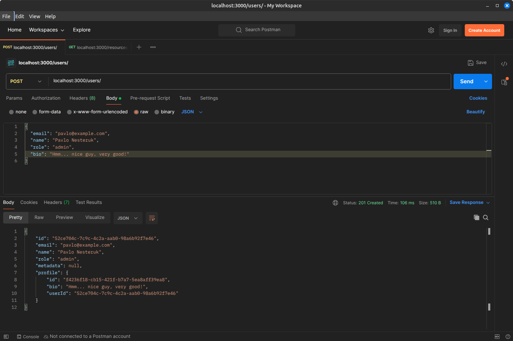
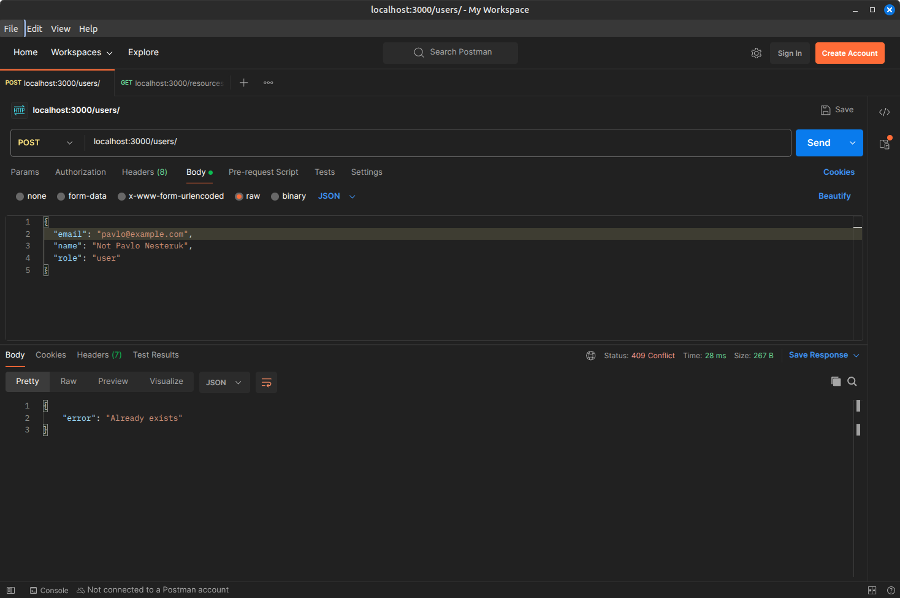
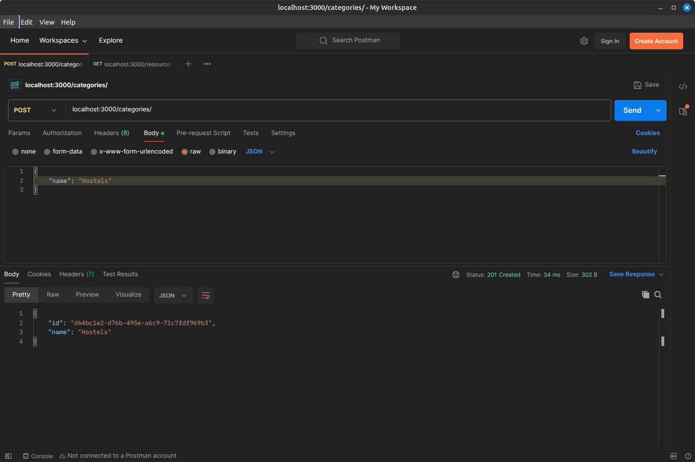
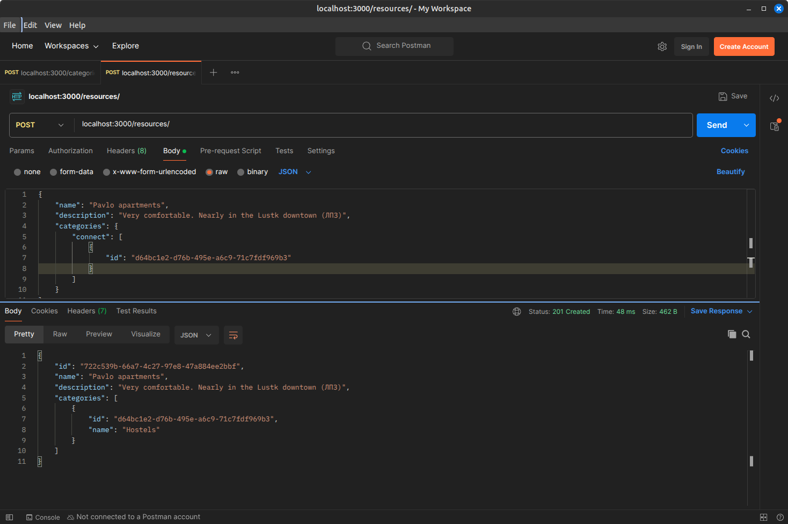
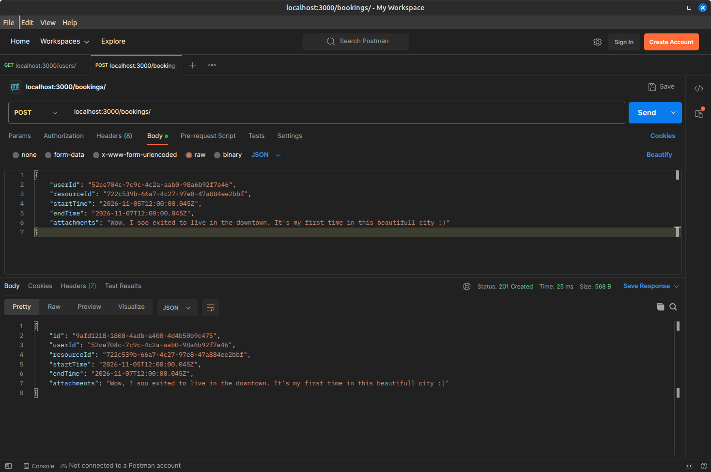

# Звіт з лабораторної роботи 1

## Тема роботи: Розроблення backend архітектури та основного функціоналу

Здобувач освіти: Нестерук Павло Романович
Група: ІПЗ-41
GitHub репозиторій: https://github.com/Solidarov/web_dev_labs

## Виконання роботи

### Налаштування проєкту
- Створено Git репозиторій
- Ініціалізовано Node.js проєкт (CommonJS, `npm`)
- Встановлено необхідні залежності: `express`, `@prisma/client`, `prisma`, `@prisma/adapter-pg`, `pg`, `zod`, `dotenv`, `swagger-ui-express`, `supertest`
- Налаштовано структуру файлів (розділення на моделі, маршрути, контролери та утиліти)
- Налаштовано змінні середовища: `.env` та шаблон `.env.example`
- Додано npm-скрипти: `npm start`, `npm run dev`, `npm test`, `npm run db:stop`. Перед запуском сервера й тестів автоматично піднімається потрібна БД у Docker і застосовуються міграції

### База даних
- Налаштовано PostgreSQL у Docker (`docker-compose.yml`): окремі контейнери для dev та test баз з healthcheck
- Створено Prisma схему (`prisma/schema.prisma`) з 6 сутностями: `User`, `Profile`, `Resource`, `Category`, `Booking`, `Notification`
- Реалізовано різні типи зв'язків: 1:1 (`User` – `Profile`), 1:N (`User` – `Booking`, `Resource` – `Booking`, `User` – `Notification`), M:N (`Category` – `Resource`)
- Закладено основу для майбутнього розширення: поле `User.role` (RBAC), поле `Booking.attachments` типу JSONB (робота з файлами), `EventEmitter` у `src/utils/eventBus.js` (real-time)
- Створено та виконано міграції Prisma (`prisma/migrations/`, початкова міграція `init`); вони застосовуються до dev та test баз автоматично командою `prisma migrate deploy` у скрипті `scripts/prepareDb.js`
- Перед стартом сервер перевіряє підключення до БД

### Backend архітектура
- Створено Express.js сервер (`src/app.js`)
- Реалізовано шарову архітектуру, подібну до MVC, без UI: маршрути (`routes`) → контролери (`controllers`) → Prisma (дані). Роль «моделей» запитів виконують Zod-схеми в `src/models/`, а моделі БД описані в `schema.prisma`
- Загальну CRUD-логіку винесено в `src/utils/crud.js` (контролери) та `src/utils/crudRouter.js` (маршрути), тому нова сутність додається кількома рядками
- Впроваджено middleware: `express.json()`, валідація тіла запиту через Zod (`validate.js`), перевірка UUID в `:id`, обробка неіснуючих маршрутів (404) та централізований обробник помилок (`errorHandler.js`), який перетворює помилки Prisma на коректні HTTP-коди (400, 404, 409, 500)
- Після створення бронювання генерується подія `bookingCreated` (event bus)

### API endpoints
Для кожного ресурсу (`/users`, `/bookings`, `/resources`, `/categories`) реалізовано повний набір CRUD-операцій:

| Метод | Шлях | Опис | Успішний код |
|-------|------|------|--------------|
| POST | `/{ресурс}` | Створення запису | 201 |
| GET | `/{ресурс}` | Список записів | 200 |
| GET | `/{ресурс}/:id` | Отримання запису за UUID | 200 |
| PATCH | `/{ресурс}/:id` | Часткове оновлення | 200 |
| DELETE | `/{ресурс}/:id` | Видалення | 204 |

Особливості:
- `POST /users` приймає необов'язкове поле `bio` і створює пов'язаний профіль (зв'язок 1:1)
- `POST /resources` дозволяє одразу прив'язати категорії через `categories: { connect: [{ id }] }`
- `POST /bookings` вимагає, щоб `endTime` було пізніше за `startTime`
- Помилки повертаються у форматі `{ "error": "..." }`

Повну інтерактивну документацію API (Swagger UI) згенеровано автоматично зі схем валідації; вона доступна за адресою `http://localhost:3000/docs`, а специфікація OpenAPI у JSON — за `http://localhost:3000/docs.json`.

Також написано 7 інтеграційних тестів (`node:test` + `supertest`), які виконуються на окремій тестовій БД (`npm test`).

## Структура проєкту

```
lab1/
├── src/
│   ├── controllers/
│   │   ├── bookingController.js
│   │   ├── categoryController.js
│   │   ├── resourceController.js
│   │   └── userController.js
│   ├── models/
│   │   ├── booking.js
│   │   ├── category.js
│   │   ├── resource.js
│   │   └── user.js
│   ├── routes/
│   │   ├── bookingRoutes.js
│   │   ├── categoryRoutes.js
│   │   ├── resourceRoutes.js
│   │   └── userRoutes.js
│   ├── utils/
│   │   ├── crud.js
│   │   ├── crudRouter.js
│   │   ├── errorHandler.js
│   │   ├── eventBus.js
│   │   ├── openapi.js
│   │   ├── prisma.js
│   │   └── validate.js
│   ├── generated/prisma/        (згенерований Prisma клієнт)
│   └── app.js
├── prisma/
│   ├── migrations/
│   │   ├── 20261101000000_init/migration.sql
│   │   └── migration_lock.toml
│   └── schema.prisma
├── scripts/
│   └── prepareDb.js
├── tests/
│   └── api.test.js
├── reports/
│   └── lab1-report.md
├── docker-compose.yml
├── prisma.config.ts
├── .env
├── .env.example
├── .gitignore
├── package.json
└── README.md
```

## Скріншоти тестування

Скрін 1. Створення користувача із bio (автоматичне створення профіля)


Скрін 2. Спроба створити користувача використовуючи вже зареєстрований e-mail


Скрін 3. Створення категорії (потрібно для ресурсів)


Скрін 4. Створення ресурсу (із категорією)


Скрін 5. Створення резервації за створеним раніше користувачем та ресурсом

## Висновки

Самооцінка: 5

Обгрунтування: усі вимоги завдання виконано повністю, а також реалізовано додаткові можливості: Docker-контейнеризацію з автоматичним налаштуванням баз даних, автоматично згенеровану Swagger-документацію API та інтеграційні тести на окремій тестовій базі.
