# Звіт з лабораторної роботи 2

## Тема роботи: Аутентифікація, авторизація та розширений функціонал

Здобувач освіти: Нестерук Павло Романович
Група: ІПЗ-41
GitHub репозиторій: https://github.com/Solidarov/web_dev_labs
Рівень складності: 3

## Реалізований функціонал

**Рівень 1**

- Реєстрація `POST /auth/register` з валідацією через Zod (`src/models/auth.js`): коректний email, непорожнє ім'я, пароль від 8 символів. Поле `role` у запиті ігнорується, новий користувач завжди отримує роль `user`. Дубльований email дає 409
- Паролі хешуються алгоритмом Argon2id (`argon2`, `src/utils/auth.js`). Поле `User.password` глобально прибрано з відповідей через `omit` у Prisma-клієнті (`src/utils/prisma.js`), тож хеш не потрапляє в API навіть випадково
- Вхід `POST /auth/login` повертає пару токенів: access-токен JWT (`jsonwebtoken`, payload `{ sub, role }`, термін `JWT_EXPIRES_IN`, за замовчуванням 15 хв) і refresh-токен. Невірний email або пароль дають однакову відповідь 401 `Invalid credentials`
- Middleware `authenticate` перевіряє заголовок `Authorization: Bearer <token>` і записує `req.user`, а при відсутньому чи невалідному токені повертає 401. `GET /auth/me` повертає поточного користувача з профілем
- Ролі `user` / `admin` (рядкове поле `User.role`, закладене ще в лабораторній 1). Першого адміністратора призначає скрипт `npm run make-admin -- <email>` (`scripts/makeAdmin.js`)
- Middleware `authorize(...roles)` повертає 403 для недозволеної ролі. Захист підключається до `crudRouter` параметрами `read` / `write`:
  - `/users`: лише `admin`
  - `/resources`, `/categories`: читання публічне, зміни лише для `admin`
  - `/bookings`: лише автентифіковані. Звичайний користувач бачить і змінює тільки власні бронювання (чужі дають 404, а не 403, щоб не розкривати їх існування), `userId` береться з токена. `admin` має повний доступ
- Пагінація для всіх списків у спільному `src/utils/crud.js`: `page`, `limit` (за замовчуванням 10, максимум 100), сортування `sort` (лише дозволені поля) та `order`. Відповідь має формат `{ data, meta: { page, limit, total, totalPages } }`, некоректні параметри дають 400 `Invalid query`
- Swagger-документація генерується автоматично зі схем Zod і мапи `resources` (`src/utils/openapi.js`) і доступна за адресами `http://localhost:3000/docs` та `http://localhost:3000/api-docs`, а специфікація OpenAPI 3.0.3 — за `/docs.json`. Захищені маршрути позначені схемою `bearerAuth`

**Рівень 2**

- Файловий сервіс на `multer` (`src/utils/upload.js`): файли зберігаються на диску в `UPLOAD_DIR` під згенерованими UUID-іменами, а їхні метадані (`id`, `originalName`, `mimetype`, `size`, `filename`, `uploadedAt`) зберігаються в полі `Booking.attachments` (JsonB), закладеному в лабораторній 1
- Валідація файлів: дозволені MIME-типи `image/jpeg`, `image/png`, `image/webp`, `application/pdf` (інакше 400 `Unsupported file type`), розмір до `MAX_FILE_SIZE` (5 МБ, інакше 413 `File too large`), не більше 5 файлів за запит
- Маршрути вкладень бронювання: `POST /bookings/:id/attachments`, `GET`, `PATCH` (заміна файлу) та `DELETE` для `/bookings/:id/attachments/:fileId`. Права власника перевіряються ще до `multer`, тож для чужого бронювання на диск нічого не записується. При помилці збережені файли видаляються (`cleanupOnError`), а метадані вкладень із тіла `POST /bookings` ігноруються
- Пошук `q` (без урахування регістру): користувачі за `name`, `email`, ресурси за `name`, `description`, категорії за `name`
- Фільтри: `role` для користувачів, `categoryId` для ресурсів, `resourceId`, `userId`, `from`, `to` для бронювань (для звичайного користувача фільтр завжди поєднується з обмеженням на власні записи), `userId`, `method`, `status` для журналу дій
- Зміна пароля `PATCH /auth/password`: перевіряє поточний пароль, хешує новий і відкликає всі активні refresh-токени користувача
- Refresh-токени: випадкові 32 байти, у БД (`AuthToken`) зберігається лише їхній SHA-256 хеш, термін дії 7 днів. `POST /auth/refresh` виконує ротацію (старий токен стає використаним, повторне використання дає 401), а умовне оновлення не дає двом паралельним запитам використати той самий токен. `POST /auth/logout` відкликає токен
- Тести аутентифікації (`tests/api.test.js`): реєстрація, вхід, `/auth/me`, ротація і повторне використання refresh-токена, logout, зміна пароля, 403 від `authorize`

**Рівень 3** (виконано пункти 1, 4, 5, 7, 8)

- Відновлення пароля через email: `POST /auth/forgot-password` завжди відповідає 202 (не розкриває, чи існує email) і для відомого користувача створює одноразовий токен на 15 хвилин (дійсний лише останній). Лист надсилається через `nodemailer` (`src/utils/mailer.js`) за подією `passwordResetRequested` на `eventBus`: через SMTP із `.env` (наприклад, Ethereal) або, без `SMTP_HOST`, лише рендериться локально в JSON. `POST /auth/reset-password` встановлює новий пароль і відкликає всі refresh-токени
- Логування дій користувачів: middleware `src/utils/actionLog.js` записує в таблицю `ActionLog` кожен запит, що змінює дані (`userId`, метод, шлях, статус відповіді, без тіла запиту). Перегляд доступний через `GET /logs` (лише `admin`, з пагінацією та фільтрами)
- Rate limiting (`express-rate-limit`, `src/utils/rateLimit.js`): глобально `RATE_LIMIT` запитів (100) на IP за 15 хвилин, а для `register`, `login`, `forgot-password`, `reset-password` суворіший `AUTH_RATE_LIMIT` (10). Перевищення дає 429 `{ "error": "Too many requests" }` і стандартні заголовки `RateLimit`. Також додано `helmet` (безпечні HTTP-заголовки) та `cors` з дозволеним джерелом `CORS_ORIGIN`
- Завантаження кількох файлів одночасно: поле `files` у `POST /bookings/:id/attachments` приймає до 5 файлів за один запит
- Розширена документація API: для кожного тіла запиту є приклад (`.meta({ example })` у `src/models/*.js`), для кожної успішної відповіді є приклад, а всі помилки описані спільною схемою `Error` (`{ error, details? }`) з прикладами для кожного можливого повідомлення. Відповіді 429 та 500 додано до всіх операцій. Окремий тест перевіряє, що кожна операція в `/docs.json` має ці приклади


Особливості реалізації порівняно з методичкою:

- Проєкт залишився на CommonJS (крок переходу на ESM пропущено), ідентифікатори залишились UUID, а роль — рядковим полем `User.role`
- Замість окремої моделі `File` метадані файлів зберігаються в `Booking.attachments` (JsonB)
- Refresh-токени не є JWT: це непрозорі випадкові рядки, хеші яких зберігаються в таблиці `AuthToken` (спільній із токенами скидання пароля), тому їх можна відкликати
- Swagger генерується зі схем Zod, а не через `swagger-jsdoc`, тож документація не розходиться з валідацією
- Нові таблиці `AuthToken` та `ActionLog` і поля `User.password`, `User.createdAt` додано міграцією `20261116230158_add_auth_tokens_and_logs`
- Помилки `multer` (розмір, тип, кількість файлів) обробляються централізовано в `src/utils/errorHandler.js`

Тестування: 34 інтеграційні тести (`node:test` + `supertest`) на окремій тестовій БД, усі проходять (`npm test`: 34 passed, 0 failed, Node.js v22.14.0). Покриття власного коду `src/` (без `src/generated/`) за вбудованим інструментом Node.js: 96.37% рядків, 86.64% гілок, 94.17% функцій.

## Ключові фрагменти коду

Middleware аутентифікації та авторизації (`src/utils/auth.js`):

```js
const authenticate = (req, res, next) => {
  const [scheme, token] = (req.headers.authorization || '').split(' ');
  try {
    if (scheme !== 'Bearer' || !token) throw new Error('No token');
    const { sub, role } = jwt.verify(token, process.env.JWT_SECRET);
    req.user = { id: sub, role };
    next();
  } catch {
    res.status(401).json({ error: 'Unauthorized' });
  }
};

const authorize =
  (...roles) =>
  (req, res, next) => {
    if (!roles.includes(req.user?.role)) return res.status(403).json({ error: 'Forbidden' });
    next();
  };
```

Підключення захисту до маршрутів (`src/routes/categoryRoutes.js`): читання публічне, зміни лише для адміністратора:

```js
module.exports = crudRouter(controller, createCategory, updateCategory, {
  write: [authenticate, authorize('admin')],
});
```

Ротація refresh-токена (`src/controllers/authController.js`): умовне оновлення гарантує, що токен буде використано лише один раз:

```js
const token = await prisma.authToken.findUnique({
  where: { tokenHash: hashToken(req.body.refreshToken) },
  include: { user: true },
});
if (!token || token.type !== 'refresh' || token.usedAt || token.expiresAt < new Date())
  return res.status(401).json({ error: 'Invalid refresh token' });
const { count } = await prisma.authToken.updateMany({
  where: { id: token.id, usedAt: null },
  data: { usedAt: new Date() },
});
if (!count) return res.status(401).json({ error: 'Invalid refresh token' });
res.json(await issueTokens(token.user));
```

Пагінація, пошук і фільтри в спільному CRUD-контролері (`src/utils/crud.js`):

```js
const page = Math.max(1, parseInt(query.page) || 1);
const limit = Math.min(100, Math.max(1, parseInt(query.limit) || 10));
const field = z.enum(sort).default(sort[0]).parse(query.sort);
const order = z.enum(['asc', 'desc']).default('asc').parse(query.order);
const q = z.string().optional().parse(query.q);
const where = {
  AND: [
    scope(req),
    q && search.length
      ? { OR: search.map((f) => ({ [f]: { contains: q, mode: 'insensitive' } })) }
      : {},
    ...Object.entries(filters)
      .filter(([key]) => query[key] !== undefined)
      .map(([key, filter]) => filter(query[key])),
  ],
};
```

Сутність лише описує, що можна шукати, сортувати й фільтрувати (`src/controllers/bookingController.js`), а `scope` обмежує звичайного користувача власними бронюваннями:

```js
const scope = (req) => (isAdmin(req) ? {} : { userId: req.user.id });

const controller = crud('booking', undefined, {
  scope,
  sort: ['startTime', 'endTime'],
  filters: {
    resourceId: (id) => ({ resourceId: z.uuid().parse(id) }),
    userId: (id) => ({ userId: z.uuid().parse(id) }),
    from: (from) => ({ startTime: { gte: z.coerce.date().parse(from) } }),
    to: (to) => ({ endTime: { lte: z.coerce.date().parse(to) } }),
  },
});
```

Налаштування завантаження файлів з валідацією типу та розміру (`src/utils/upload.js`):

```js
const allowedTypes = ['image/jpeg', 'image/png', 'image/webp', 'application/pdf'];

const upload = multer({
  storage: multer.diskStorage({
    destination: dir,
    filename: (_req, file, cb) =>
      cb(null, crypto.randomUUID() + path.extname(file.originalname).toLowerCase()),
  }),
  fileFilter: (_req, file, cb) =>
    allowedTypes.includes(file.mimetype)
      ? cb(null, true)
      : cb(Object.assign(new Error('Unsupported file type'), { code: 'UNSUPPORTED_FILE_TYPE' })),
  limits: { fileSize: Number(process.env.MAX_FILE_SIZE) || 5 * 1024 * 1024, files: 5 },
});
```

Журнал дій користувачів (`src/utils/actionLog.js`):

```js
module.exports = (req, res, next) => {
  if (!readOnly.includes(req.method))
    res.on('finish', () => {
      prisma.actionLog
        .create({
          data: {
            userId: req.user?.id ?? null,
            method: req.method,
            path: req.originalUrl.split('?')[0],
            status: res.statusCode,
          },
        })
        .catch(console.error);
    });
  next();
};
```

Приклад запиту для Swagger задається прямо в схемі валідації (`src/models/auth.js`):

```js
exports.register = z
  .object({ email: z.email(), name: z.string().min(1), password })
  .meta({ example: { email, name: 'Anna Koval', password: 'secret123' } });
```

## Скріншоти

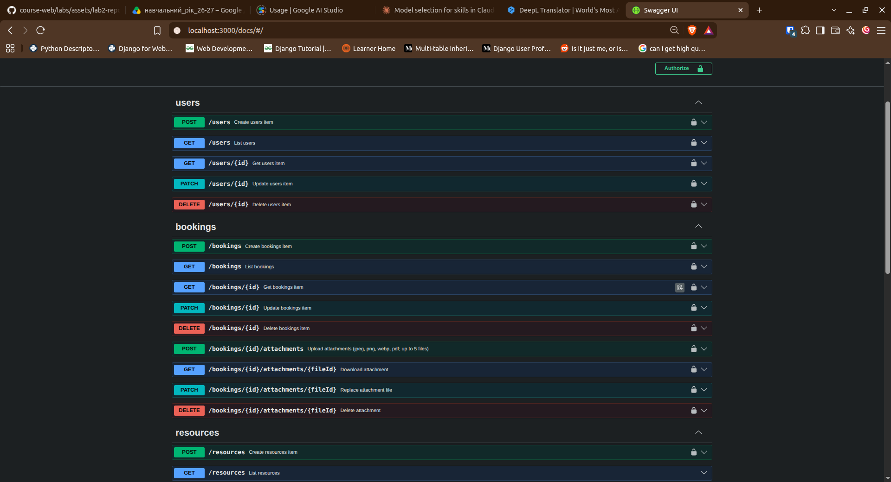
Скрін 1. Swagger UI зі списком усіх маршрутів

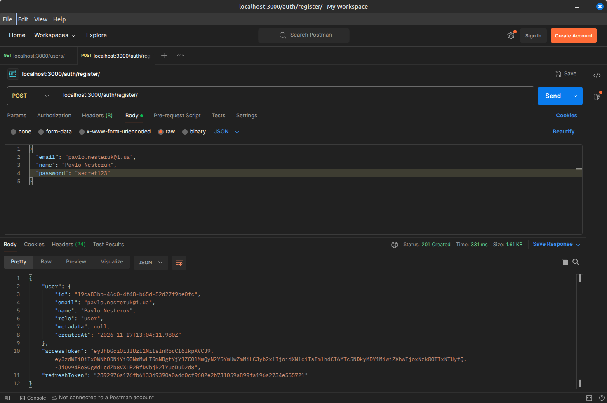
Скрін 2. Реєстрація користувача

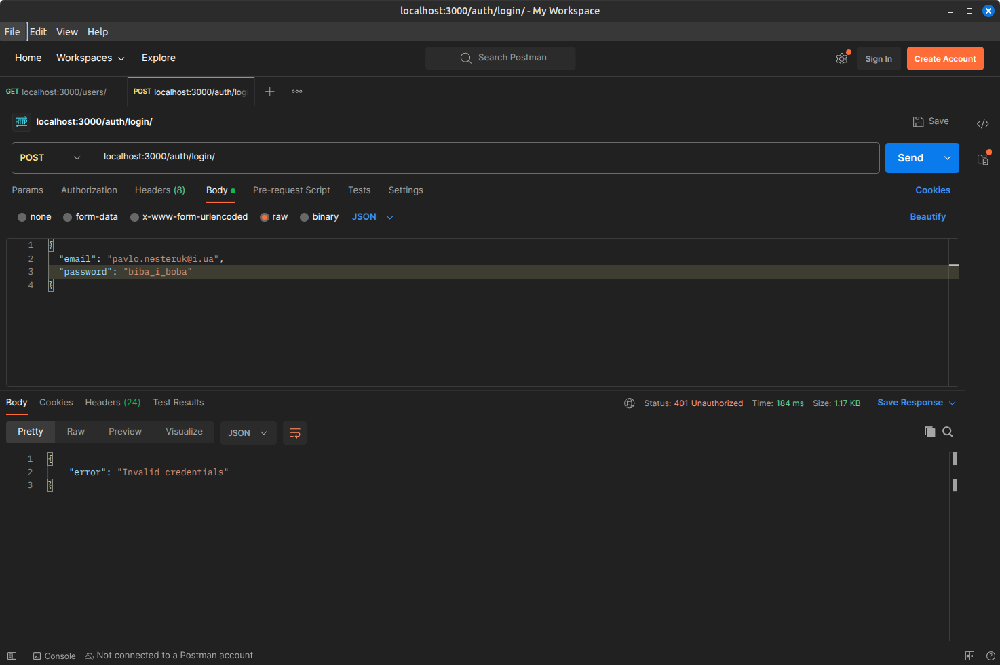
Скрін 3. Вхід із неправильним паролем

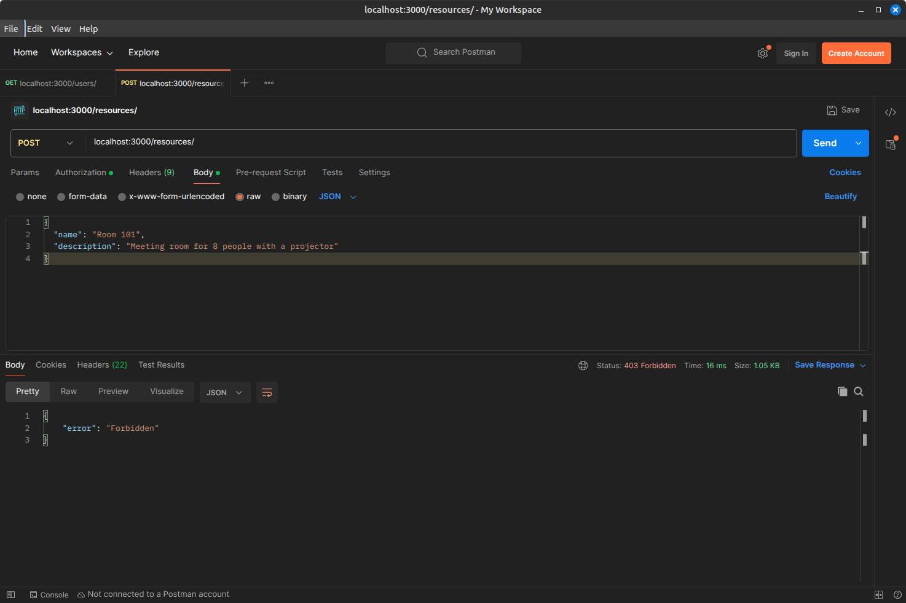
Скрін 4. Звичайний користувач намагається створити ресурс

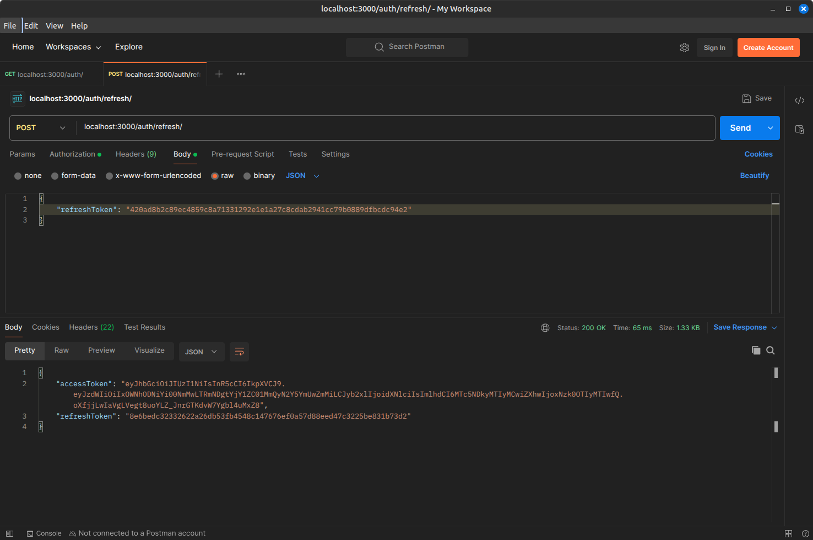
Скрін 5. Ротація refresh-токена

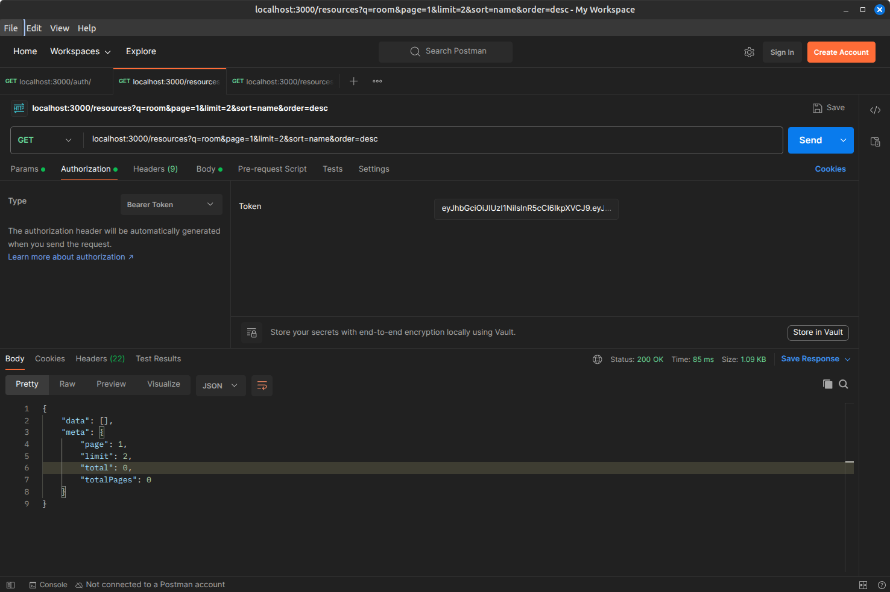
Скрін 6. Пагінація, пошук і сортування

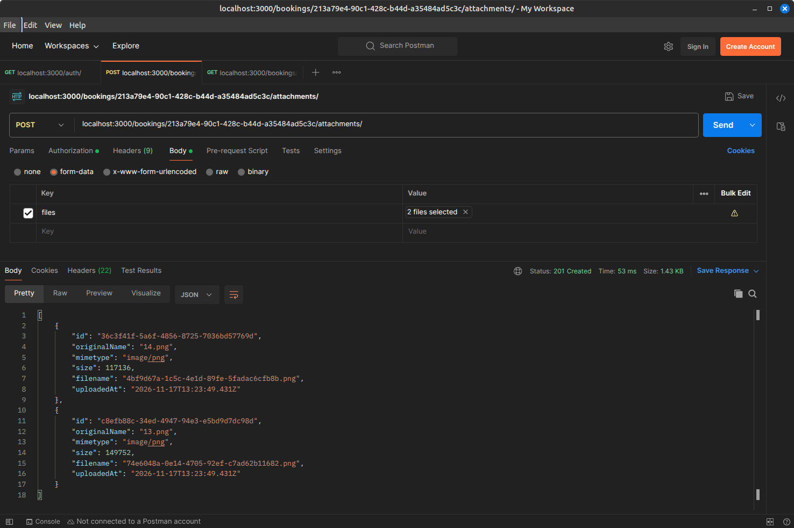
Скрін 7. Завантаження кількох файлів до бронювання

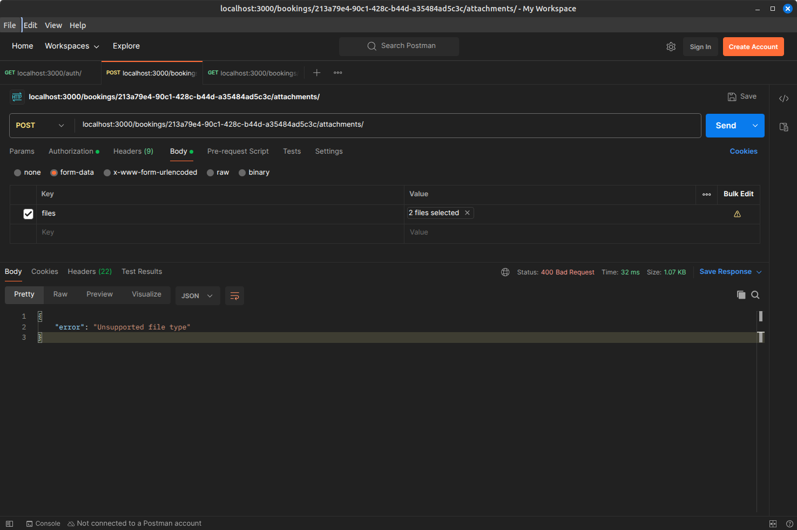
Скрін 8. Завантаження файлу недозволеного типу

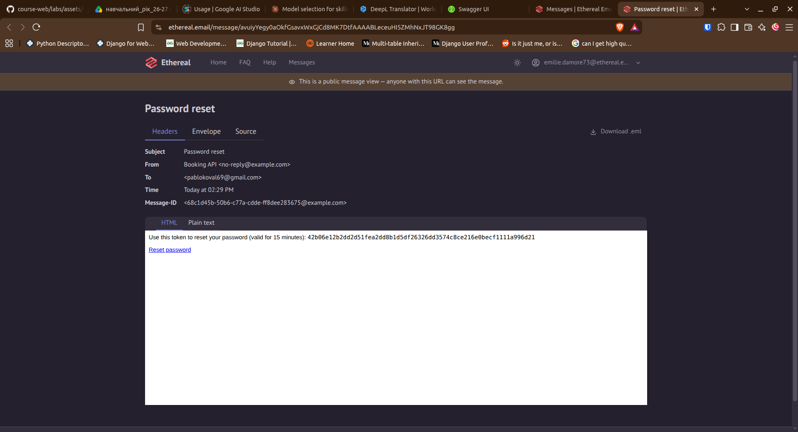
Скрін 9. Лист для відновлення пароля (*на прикладі Ethereal сервісу із фейковим листом*)

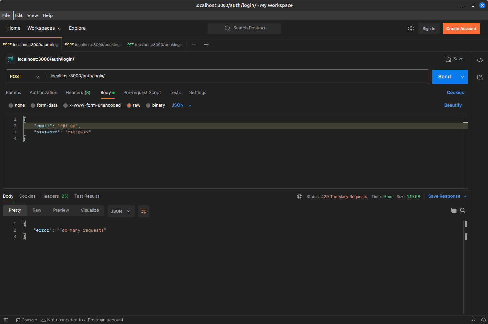
Скрін 10. Перевищення ліміту запитів

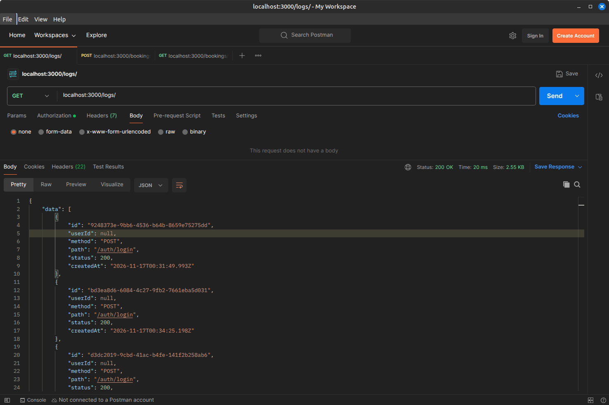
Скрін 11. Журнал дій користувачів

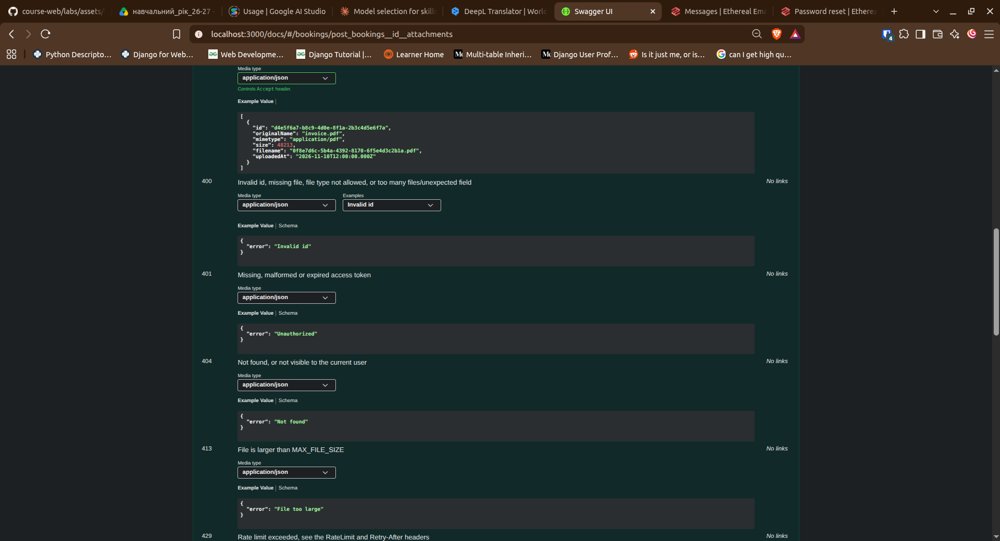
Скрін 12. Опис помилок у Swagger

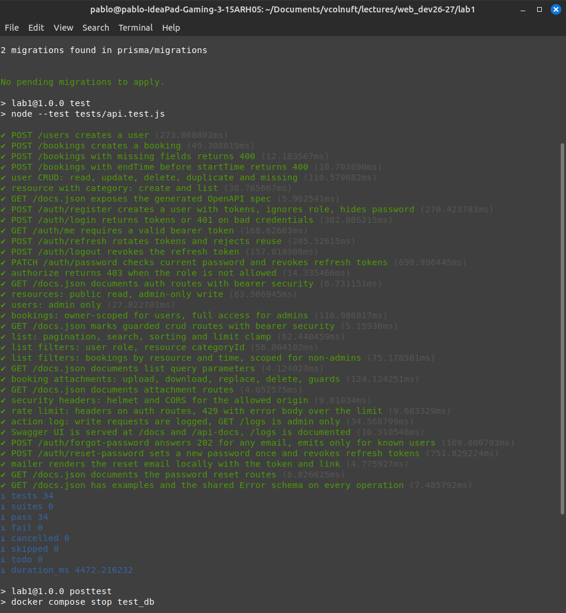
Скрін 13. Результат запуску тестів

## Висновки

Самооцінка: 5

Обгрунтування: усі пункти рівнів 1 і 2 виконано; з рівня 3 виконано відновлення пароля через email, журнал дій, rate limiting (разом із helmet і CORS), завантаження кількох файлів і розширену документацію з прикладами та всіма помилками; 34 тести проходять.
